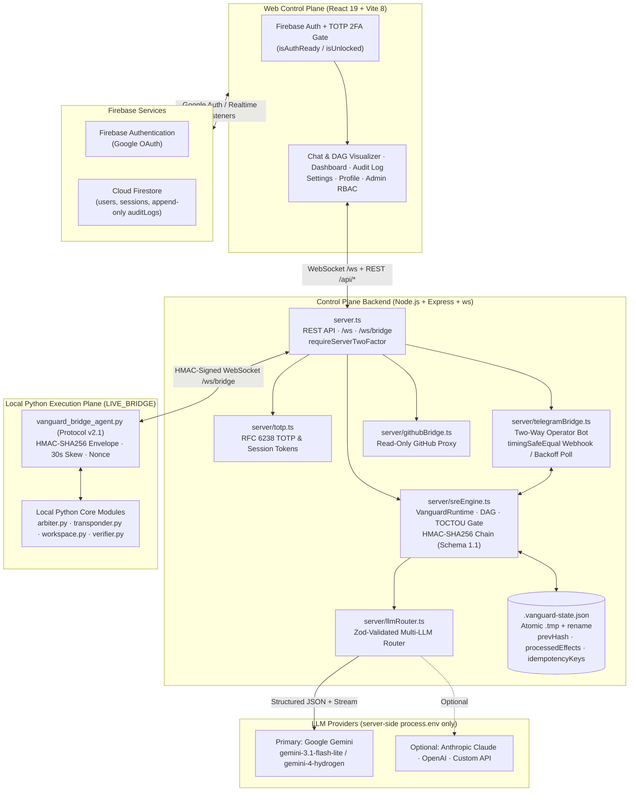

# Vanguard SRE — Control Plane

[](https://www.typescriptlang.org/)
[](https://expressjs.com/)
[](https://vite.dev/)
[](./vanguard_bridge_agent.py)
[-blue)](#license)


A deterministic web Control Plane for operating autonomous Site Reliability Engineering (SRE) agents with strict separation between reasoning and execution. An LLM proposes execution steps, patch hypotheses, and risk assessments, while the Control Plane enforces the Directed Acyclic Graph (DAG) state machine, tamper-evident HMAC-SHA256 audit ledger, TOCTOU-protected human-in-the-loop (HITL) approval gates, and three-layer rollback policies across a Zero Trust boundary.

---

## Architecture



---

## Execution Modes

The Control Plane separates execution into three explicit modes selectable in the chat header (`ChatWorkspaceView.tsx`) and `SettingsView.tsx`, or initialized via `VANGUARD_MODE`:

| Mode | LLM Calls | Disk / Host Access | `dry_run` Flag | Primary Use Case | Failure Behavior |
|---|---|---|---|---|---|
| **`AI_SANDBOX`** *(default when any LLM key is set)* | Real server-side call via `server/llmRouter.ts` (default `gemini-3.1-flash-lite`) with strict Zod validation (`AiSandboxPlanSchema`) | None (read-only analysis; files are never modified) | `true` on every step (`dryRun: true`) + UI notice *"Анализ в песочнице (файлы не изменены)"* | Decomposing arbitrary SRE prompts into DAG steps, patch hypotheses, risk ratings, and verifier criteria | **No silent fallback.** Raises `AiSandboxError` (`LLM_NO_KEY`, `LLM_QUOTA_EXCEEDED`, `LLM_API_ERROR`, `LLM_SCHEMA_INVALID`), records `SANDBOX_LLM_ERROR` in the HMAC audit log, and exposes explicit Retry / Switch-to-`MOCK_DEMO` actions. |
| **`MOCK_DEMO`** *(default when no LLM key is set)* | None (`buildMockDemoPlan`) | None | `true` | Deterministic offline UI verification, three-layer rollback drills, and HITL Approval Gate walkthroughs | Deterministic local execution; no external network dependency. |
| **`LIVE_BRIDGE`** | Optional planner when an LLM key is set; dispatches signed `TASK_DISPATCH` over `/ws/bridge` | Local workspace via `vanguard_bridge_agent.py` | `false` | Production or local lab execution against the Python Execution Plane (`arbiter.py`, `workspace.py`, `verifier.py`) | Switching to `LIVE_BRIDGE` is blocked (`409`) unless a live bridge socket is connected or `VANGUARD_BRIDGE_URL` is configured. |

---

## Security Model & Guarantees

1. **Zero Secrets in Client or Firestore**
   - All API keys, bot tokens, HMAC keys, and signing secrets are read exclusively on the server from `process.env`.
   - `GET /api/system/integrations-status` returns only boolean configuration flags and last-4 masked suffixes (`maskSecret` in `server/protocolSchema.ts`). No secret input fields exist in the React UI or Firestore documents.
2. **Tamper-Evident HMAC-SHA256 Audit Ledger (Transponder Schema `1.1`)**
   - Every runtime, security, and operator event is chained via `prev` (previous event hash, rooted at 64-zero `GENESIS`) and signed with `HMAC-SHA256` over canonical JSON (`canonicalJson`) in `server/sreEngine.ts`.
   - `POST /api/audit/verify-chain` recalculates every link on the server and identifies the exact `brokenIndex` and `brokenEventId` on tampering.
   - In Cloud Firestore (`firestore.rules`), `auditLogs` is enforced as strictly append-only (`allow update, delete: if false;`).
3. **Atomic State Persistence & Anti-Replay / TOCTOU Protection**
   - `VanguardRuntime` persists `globalSeq`, `globalTip` (latest `prevHash`), `chainOriginSeq`, `chainOriginPrev`, `fullEventChain` (last 500 events), `processedEffects` (up to 2,000), and `usedIdempotencyKeys` (up to 2,000) to `.vanguard-state.json` (or `VANGUARD_STATE_FILE`) using atomic write-to-temp (`.tmp`) + `fs.renameSync`.
   - `decideApproval()` validates `effectId`, one-time `idempotencyKey`, and `expectedAnchorHash` (TOCTOU drift check). Replays across Web UI, Telegram, or container restarts are rejected with HTTP `409 Conflict` (`EFFECT_ALREADY_DECIDED`, `IDEMPOTENCY_KEY_MISMATCH`, `ANCHOR_DRIFT_TOCTOU`) and logged as `APPROVAL_CONFLICT_409`.
4. **Ephemeral Secret Transparency**
   - If `TRANSPONDER_SECRET` or `TWO_FACTOR_SESSION_SECRET` is omitted from `process.env`, the server starts safely using cryptographically random ephemeral keys (`crypto.randomBytes(32)`) and sets `ephemeralSecrets: true` (with per-key `ephemeralSecretDetails`) in `GET /api/system/integrations-status` and `GET /api/health`.
   - `SettingsView.tsx` renders an amber warning banner notifying operators that 2FA sessions and the HMAC chain origin reset across restarts until persistent secrets are configured. (Persisted `processedEffects` and `usedIdempotencyKeys` are still restored across restarts.)
5. **Authentication, Server-Side 2FA, RBAC, and Client Lifecycle Gating**
   - Users authenticate via Firebase Auth (Google OAuth). TOTP 2FA (RFC 6238, SHA-1, 6 digits, 30s period, ±1 window, constant-time comparison via `crypto.timingSafeEqual`, plus 8 backup codes) issues server-signed `base64url` session tokens (1-hour TTL) verified by `requireServerTwoFactor` on mutating REST routes and `checkWsTwoFactor` on WebSocket commands.
   - TOTP secrets in Firestore live under owner-only `users/{userId}/security/{docId}` (`allow list: if false;`).
   - Sensitive downloads (`GET /api/bridge/agent-script`) enforce both `requireServerTwoFactor` and role verification (`x-vanguard-uid` + `x-vanguard-role` in `admin | operator`).
   - Client components gate all Firestore listeners, `/api/*` requests, and `/ws` connections behind `isAuthReady` (`src/contexts/AuthContext.tsx`) and `isUnlocked` (`src/App.tsx`).
6. **Hardened Telegram Operator Control**
   - `POST /api/telegram/webhook` validates `X-Telegram-Bot-Api-Secret-Token` against `TELEGRAM_WEBHOOK_SECRET` using `crypto.timingSafeEqual`. If `TELEGRAM_WEBHOOK_SECRET` is unset, the webhook endpoint is disabled and returns `503 Webhook disabled without TELEGRAM_WEBHOOK_SECRET`; missing or mismatched headers return `403` and emit `TELEGRAM_WEBHOOK_REJECTED`.
   - Outbound long-polling (`server/telegramBridge.ts`) runs with exponential backoff (`2s` to `60s`), catches `409 Conflict` (cleanly halting polling after 3 consecutive conflicts), and isolates network failures so Express never crashes.
   - Inline approval callbacks are restricted to `TELEGRAM_ALLOWED_CHAT_IDS`; unauthorized chat IDs emit `TELEGRAM_UNAUTHORIZED_CHAT` (`CRITICAL`).
7. **Bridge Channel Authentication & SSRF Protection**
   - `/ws/bridge` verifies every frame via `verifyBridgeEnvelope()` (Zod schema + `HMAC-SHA256` over canonical JSON + 30-second timestamp skew window + nonce deduplication), closing invalid peers with code `4003`.
   - `POST /api/integrations/test` blocks loopback, RFC 1918 private ranges (`10.*`, `192.168.*`), link-local (`169.254.*`), and `metadata.google.internal`.

---

## Repository Layout

| Path | Role |
|---|---|
| `server.ts` | Express HTTP server, Vite middleware / static serving, REST endpoints, `/ws` client WebSocket server, and `/ws/bridge` Python Bridge WebSocket server. |
| `server/sreEngine.ts` | `VanguardRuntime`: DAG execution engine, three-layer rollback, CAS SHA-256 blob store, HMAC-SHA256 Transponder chain, atomic `.vanguard-state.json` persistence, TOCTOU Approval Gate, and bridge telemetry. |
| `server/llmRouter.ts` | Multi-LLM router (Google Gemini primary; Anthropic, OpenAI, Custom OpenAI-compatible optional), Zod-validated `AI_SANDBOX` planner, `MOCK_DEMO` planner, streaming reports, and `AiSandboxError`. |
| `server/protocolSchema.ts` | Zod schemas for execution modes, sandbox plans, DAG packets, approvals, bridge envelopes, canonical JSON serialization, secret masking, and HMAC envelope signing/verification. |
| `server/totp.ts` | RFC 6238 TOTP generation/verification, QR code generation, recovery backup codes, and HMAC-signed server 2FA session tokens. |
| `server/telegramBridge.ts` | Two-way Telegram Bot API client: `timingSafeEqual` webhook verification, backoff long-polling with `409 Conflict` handling, inline approval buttons, and severity-filtered notifications. |
| `server/githubBridge.ts` | Read-only server-side GitHub REST API proxy (branches, commits, open PRs, latest commit SHA binding). |
| `vanguard_bridge_agent.py` | Reference Python Execution Plane connector (protocol v2.1) with HMAC-SHA256 framing, companion module auto-detection, heartbeat loop, exponential reconnect backoff, and `arbiter.py` / `transponder.py` hooks. |
| `firestore.rules` | Default-deny Firestore security rules enforcing schema validation, RBAC, owner-only 2FA secrets, and append-only `auditLogs`. |
| `firebase-blueprint.json` | Canonical Firestore collection schema synchronized with `firestore.rules`. |
| `src/App.tsx` | Authenticated application shell, `isUnlocked` lifecycle gate, Firestore subscriptions, WebSocket coordination, and LLM/mode state management. |
| `src/firebase.ts` | Firebase SDK initialization, Firestore error normalization, and auth-gated `testConnection()`. |
| `src/contexts/AuthContext.tsx` | Firebase Auth state lifecycle (`isAuthReady`), profile/settings/2FA listeners, `AbortController`-managed 2FA sync, and auth header builder (`getAuthHeaders`). |
| `src/hooks/useWebSocket.ts` | Resilient `/ws` client with exponential reconnect backoff, clean `CONNECTING`-safe teardown, streaming state, and structured `ChatStreamError`. |
| `src/views/ChatWorkspaceView.tsx` | Streaming SRE chat, 3-mode selector, configured LLM selector, TOCTOU Approval Gate, `EMERGENCY ABORT` modal, and honest `AI_SANDBOX` error recovery panel. |
| `src/views/DashboardView.tsx` | Live Arbiter metrics, Recharts visualizations (`chartsReady` RAF gate), GitHub repository bridge panel, and external API health status table. |
| `src/views/AuditLogView.tsx` | Unified real-time + Firestore Transponder log, time/severity/type filters, server-side HMAC chain integrity verifier, and CSV/JSON export. |
| `src/views/SettingsView.tsx` | Zero-clutter 4-card env configuration panel, `ephemeralSecrets` amber warning, collapsed optional LLM spoiler, Local Python Core Quick-Connect wizard, live bridge telemetry, and Arbiter policy editor. |
| `src/views/SessionsView.tsx` | Session history, status controls, and active session switcher. |
| `src/views/ProfileView.tsx` | Operator profile management and TOTP 2FA enrollment/backup code lifecycle. |
| `src/views/AdminPanelView.tsx` | Admin-only RBAC table backed by server-side `POST /api/rbac/authorize` 2FA verification. |
| `src/components/` | `AuthGate.tsx`, `TwoFactorGate.tsx`, `DagVisualizer.tsx`, `Sidebar.tsx`, `ErrorBoundary.tsx`. |
| `src/utils/notifications.ts` | Browser Web Notifications API helper for Approval Gate, rollback, and abort alerts. |

---

## Quick Start

### Prerequisites

- **Node.js** `22+` (`@types/node ^22.14.0`; `tsx` is included in `devDependencies`)
- **Python** `3.10+` with `websockets` *(only required if running `vanguard_bridge_agent.py` in `LIVE_BRIDGE` mode)*
- **Firebase Project** with Google Authentication and Cloud Firestore configured in `firebase-applet-config.json` and `firestore.rules` deployed

### Local Setup & Run

```bash
# 1. Install Node.js dependencies
npm install

# 2. Create local environment file from template
cp .env.example .env
# Edit .env and set at least GEMINI_API_KEY (or leave unset to run in MOCK_DEMO)

# 3. Start development server (Express + WebSockets + Vite middleware on port 3000)
npm run dev
```

### Production Build & Start

```bash
# Compile frontend bundle into dist/
npm run build

# Start Express server serving dist/ and WebSockets on PORT (default 3000)
NODE_ENV=production npm start
```

> **Note:** `npm start` executes `node server.ts` (requires Node.js 22.6+ native TypeScript execution). On older Node 22 builds, run `NODE_ENV=production npx tsx server.ts`.

---

## Environment Variables

All variables are defined in `.env.example` and loaded server-side via `dotenv/config`.

### 1. Core / Runtime

| Variable | Default | Description |
|---|---|---|
| `APP_URL` | `http://localhost:3000` | Public base URL of the Control Plane instance. |
| `PORT` | `3000` | HTTP and WebSocket listen port (`server.ts`). |
| `VANGUARD_MODE` | `AI_SANDBOX` *(if LLM key set)* / `MOCK_DEMO` | Initial execution mode: `AI_SANDBOX`, `MOCK_DEMO`, or `LIVE_BRIDGE`. |
| `GEMINI_API_KEY` | *(empty)* | Primary LLM API key for Google Gemini (`gemini-3.1-flash-lite` default, `gemini-4-hydrogen` selectable). |

### 2. Production Hardening

| Variable | Default | Description |
|---|---|---|
| `TRANSPONDER_SECRET` | *(ephemeral random 32B)* | Persistent HMAC-SHA256 signing key for the Transponder audit chain. Required to preserve HMAC chain continuity across server restarts. |
| `TWO_FACTOR_SESSION_SECRET` | *(falls back to `TRANSPONDER_SECRET` or ephemeral)* | Signing secret for server-issued TOTP 2FA session tokens. Required to keep active 2FA sessions valid across restarts. |
| `VANGUARD_STATE_FILE` | `.vanguard-state.json` | Path to the atomic JSON persistence file storing `globalTip` (`prevHash`), recent event chain, `processedEffects`, and `usedIdempotencyKeys`. |
| `VANGUARD_BRIDGE_HMAC_SECRET` | *(empty)* | Shared HMAC-SHA256 secret authenticating `/ws/bridge` envelopes between the Control Plane and `vanguard_bridge_agent.py`. |
| `VANGUARD_BRIDGE_URL` | *(empty)* | Optional HTTP/WS URL of an external bridge endpoint for health probing (`POST /api/system/test-bridge`) and startup `LIVE_BRIDGE` eligibility. |

### 3. Optional Integrations

| Variable | Default | Description |
|---|---|---|
| `ANTHROPIC_API_KEY` | *(empty)* | Enables Anthropic Claude (`claude-sonnet-4-20250514`, `claude-3-5-haiku-latest`) in the optional LLM router. |
| `OPENAI_API_KEY` | *(empty)* | Enables OpenAI (`gpt-4o-mini`, `gpt-4o`) in the optional LLM router. |
| `CUSTOM_LLM_API_KEY` | *(empty)* | API key for any OpenAI-compatible endpoint (requires `CUSTOM_LLM_BASE_URL`). |
| `CUSTOM_LLM_BASE_URL` | *(empty)* | Base URL for OpenAI-compatible API (e.g. `https://api.example.com/v1`). |
| `CUSTOM_LLM_MODEL` | `gpt-4o-mini` | Model identifier sent to `CUSTOM_LLM_BASE_URL`. |
| `GITHUB_TOKEN` | *(empty)* | GitHub Personal Access Token for read-only repository telemetry. |
| `GITHUB_DEFAULT_REPO` | *(empty)* | Target repository in `owner/repo` format (requires `GITHUB_TOKEN`). |
| `TELEGRAM_BOT_TOKEN` | *(empty)* | Telegram Bot API token for alerts and inline Approval Gate controls. |
| `TELEGRAM_ALLOWED_CHAT_IDS` | *(empty)* | Comma-separated allowlist of authorized Telegram chat IDs (e.g. `123456789,-100987654321`). |
| `TELEGRAM_WEBHOOK_SECRET` | *(empty)* | Required only when exposing `POST /api/telegram/webhook`. Validated against `X-Telegram-Bot-Api-Secret-Token` via `crypto.timingSafeEqual`. Leave unset to keep webhook disabled (`503`) and use outbound long-polling only. |

---

## Connecting Local Python Bridge

The Control Plane connects to the local Python Execution Plane (`Sega757/Vanguard-SRE-State-Rollback-Engine-`) over an HMAC-SHA256 authenticated WebSocket channel (`/ws/bridge`).

### 1. Obtain `vanguard_bridge_agent.py`

- Use the file in this repository root, or download it directly from the running Control Plane via **Settings → Python Live Bridge → Подключить локальное Python-ядро** (`GET /api/bridge/agent-script`, available to authenticated `admin` and `operator` roles).
- Place `vanguard_bridge_agent.py` in the same directory as the Python core modules: `arbiter.py`, `transponder.py`, `workspace.py`, `verifier.py` (and optionally `audit.py`, `blobstore.py`, `effects.py`). The agent automatically discovers and imports companion modules at startup (`detect_companion_modules()`).

### 2. Install Dependency & Launch

`vanguard_bridge_agent.py` is configured via environment variables (no CLI flags):

```bash
pip install websockets

VANGUARD_CONTROL_PLANE_WS="ws://localhost:3000/ws/bridge" \
VANGUARD_BRIDGE_HMAC_SECRET="your-shared-secret" \
VANGUARD_WORKSPACE_DIR="./workspace" \
python3 vanguard_bridge_agent.py
```

Optional environment variable: `VANGUARD_HEARTBEAT_SEC` (default `15`, minimum `5`).

### 3. Protocol v2.1 Framing & Live Telemetry

- Every packet in both directions is wrapped in `{ timestamp, nonce, signature, payload }` where `signature = HMAC-SHA256(secret, canonical_json({ timestamp, nonce, payload }))`.
- Both sides enforce a **30-second timestamp skew window** and **nonce deduplication** to block replay attacks.
- On connect, the agent sends `BRIDGE_HELLO` (`agentVersion`, `protocolVersion: "2.1"`, `workspace`, discovered `modules`, and initial `anchorCommit`), then emits signed `HEARTBEAT` frames every 15 seconds and responds to `PING` probes with `PONG` echoing `pingSentAt` for RTT latency measurement.
- On disconnect, the agent reconnects automatically with exponential backoff (`2s` up to `30s`).
- Live telemetry (last valid HMAC heartbeat timestamp, RTT latency in ms, protocol version, and detected local modules) is streamed to the browser via `mode:updated` and displayed in real time inside `SettingsView.tsx`.
- Local core integration points are exposed in `LocalExecutionBridge.run_local_arbiter_hook()` (calls `arbiter.execute_bridge_task(...)` if present) and `LocalExecutionBridge.emit_local_transponder_hook()` (calls `transponder.record_bridge_event(...)` if present).

---

## API & WebSocket Reference

### HTTP Endpoints (`server.ts`)

| Method | Path | Protection | Purpose |
|---|---|---|---|
| `GET` | `/api/health` | Public | Liveness check, active `mode`, `wsClients`, `geminiConfigured`, `ephemeralSecrets`. |
| `GET` | `/api/metrics/snapshot` | Public | Runtime KPIs, bucketed step/rollback/latency/CPU metrics, and core service statuses. |
| `GET` | `/api/system/integrations-status` | Public (masked) | Non-secret status of LLM providers (`tier`, `configured`, masked last-4), Python Bridge, GitHub, Telegram, and `ephemeralSecrets`. |
| `GET` | `/api/bridge/agent-script` | `requireServerTwoFactor` + RBAC (`admin` \| `operator`) | Serves `vanguard_bridge_agent.py` as `text/x-python` attachment. |
| `POST` | `/api/mode` | `requireServerTwoFactor` + Zod | Switches runtime execution mode (`MOCK_DEMO`, `AI_SANDBOX`, `LIVE_BRIDGE`). Returns `409` if `LIVE_BRIDGE` has no connected/configured bridge. |
| `POST` | `/api/approval/decide` | `requireServerTwoFactor` + Zod + TOCTOU | Submits `APPROVE`, `REJECT`, or `EMERGENCY_ABORT` with `effectId`, `idempotencyKey`, and `expectedAnchorHash`. Returns `409 Conflict` on replay or anchor drift. |
| `POST` | `/api/emergency-abort` | `requireServerTwoFactor` + Zod | Triggers immediate `SIGKILL` dispatch (in `LIVE_BRIDGE`) and three-layer rollback to last verified anchor. |
| `POST` | `/api/audit/verify-chain` | Public | Recomputes and verifies the entire server-side HMAC-SHA256 Transponder chain. |
| `POST` | `/api/rbac/authorize` | `requireServerTwoFactor` | Server-side 2FA gate and HMAC audit entry required before admin role mutations in Firestore. |
| `POST` | `/api/2fa/status` | Session sync | Registers per-UID server-side 2FA enforcement state. |
| `POST` | `/api/2fa/generate` | Session setup | Generates RFC 6238 TOTP secret, `otpauth://` URI, QR data URL, and 8 recovery codes. |
| `POST` | `/api/2fa/verify` | TOTP / backup code | Verifies 6-digit TOTP or recovery code and issues a 1-hour HMAC-signed 2FA session token. |
| `POST` | `/api/2fa/logout` | `x-vanguard-2fa-token` | Revokes the active server-side 2FA token JTI. |
| `POST` | `/api/system/test-llm` | `requireServerTwoFactor` | Probes configured LLM provider (`provider`, optional `model`) and returns latency. |
| `POST` | `/api/system/test-bridge` | `requireServerTwoFactor` | Sends signed `PING` to connected Python Bridge or probes `VANGUARD_BRIDGE_URL`. |
| `POST` | `/api/system/test-telegram` | `requireServerTwoFactor` | Calls Telegram `getMe` and reports allowlist size. |
| `POST` | `/api/system/test-github` | `requireServerTwoFactor` | Verifies `GITHUB_TOKEN` and repository accessibility. |
| `POST` | `/api/system/telegram-filter` | `requireServerTwoFactor` | Updates minimum notification severity and enable toggle for Telegram alerts. |
| `POST` | `/api/telegram/webhook` | `X-Telegram-Bot-Api-Secret-Token` (`timingSafeEqual`) | Receives Telegram webhook updates (`503` if `TELEGRAM_WEBHOOK_SECRET` unset; `403` on missing/invalid header). |
| `GET` | `/api/github/overview` | Public | Read-only proxy returning repository branches, recent commits, and open Pull Requests. |
| `POST` | `/api/integrations/test` | `requireServerTwoFactor` + SSRF filter | Health-checks a registered external HTTP(S) integration with private/loopback host blocking. |

### WebSocket Channels (`server.ts`)

| Endpoint | Framing & Auth | Message Types |
|---|---|---|
| `WS /ws` | JSON validated by `WsClientMessageSchema` + `checkWsTwoFactor` on mutating actions | **Client → Server:** `auth:handshake`, `session:join`, `agent:task`, `approval:response`, `emergency:abort`, `mode:switch`, `config:update`.<br/>**Server → Client:** `ws:connected`, `mode:updated`, `metrics:update`, `session:state`, `transponder:event`, `approval:required`, `approval:conflict`, `auth:2fa_required`, `chat:stream_start`, `chat:token`, `chat:complete`, `chat:error`. |
| `WS /ws/bridge` | HMAC-SHA256 signed envelope (`BridgeSignedEnvelopeSchema`, 30s skew, nonce dedup) + `BridgePayloadSchema` | **Agent → Server:** `BRIDGE_HELLO`, `HEARTBEAT`, `PONG`, `DAG_NODE`, `VERIFIER_VERDICT`, `APPROVAL_REQUIRED`, `EMERGENCY_ABORT_ACK`, `BRIDGE_ACK`.<br/>**Server → Agent:** `PING`, `TASK_DISPATCH`, `APPROVAL_DECISION`, `ARBITER_POLICY`, `EMERGENCY_ABORT`. |

---

## Verification

Run the repository verification commands defined in `package.json`:

```bash
# TypeScript static type check
npm run lint          # executes: tsc --noEmit

# Production frontend bundle check
npm run build         # executes: vite build

# Optional Python bridge syntax verification
python3 -m py_compile vanguard_bridge_agent.py
```

---

## Related Projects

- **[Vanguard SRE — State & Rollback Engine](https://github.com/Sega757/Vanguard-SRE-State-Rollback-Engine-)** — Python Execution & Rollback Core (`arbiter.py`, `transponder.py`, `workspace.py`, `verifier.py`).
- **[Metacore Hub](https://github.com/Sega757/Metacore-Hub)** — Daemon-Owned Task State Machine.
- **[Meta-Core Hardening v3](https://github.com/Sega757/Meta-core-hardening-v3)** — Hardened Execution Reference Core.

---

## License

Intended under **Apache-2.0** (matching the SPDX headers in the source tree). Note: a standalone `LICENSE` file is not currently present in the repository root and should be added prior to public release.
Licensed under the [Apache License 2.0](./LICENSE).